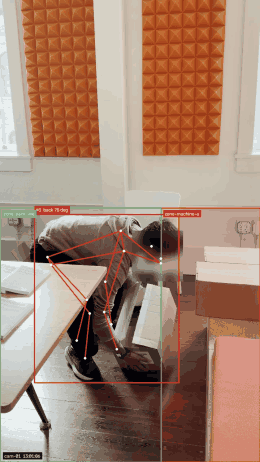

# saesr

Computer vision threat detection for warehouses. Cameras you already have, watched by models that flag unsafe lifts, people in machine zones and food-hygiene misses the moment they happen. Every risk is verified by AI agents, fixed end to end, and checked again to confirm the fix worked: detect, triage, coach, fix, verify, report.

<p align="center"></p>

<p align="center"><em>A real stoop lift, flagged about 1.5 s after the posture starts. Faces are blurred before any frame is saved.</em></p>

## Why it matters

- **Lifting injuries are the most expensive workplace injury.** Overexertion from handling objects costs US employers about $14 billion a year in direct workers' compensation costs, the top cause in the Liberty Mutual Workplace Safety Index.
- **One hygiene miss on a food line can become a recall.** The industry benchmark (GMA/FMI) puts the average food recall at about $10 million in direct costs, before lost sales and brand damage.
- **The cameras are already on the wall.** saesr is software only: it runs on existing CCTV, verifies each risk before anyone is paged, acts on it, and checks that the fix held.

## What it does today

- **Unsafe lift:** stoop lifts (back bent past 45 degrees without squatting, hands low) fire in about 1.5 s; correct squat lifts do not. Tuned on real footage.
- **Machine zone breach:** a person's feet inside a hazard zone for more than a second.
- **Verified, closed loop:** every detection becomes an incident in a Durable Actor, goes through triage, coaching and fixes by Agent Relay agents, then a verification window decides resolved or recurring.
- **Escalation to people:** the worker is coached first by iMessage (Photon); if the same violation recurs after coaching, the floor manager gets an URGENT text and an automated phone call (AgentPhone).
- **Tiered autonomy:** coaching and corrective records run automatically; slowing a machine waits for a human approval.
- **Crash-proof:** kill the backend mid-incident and it comes back in about 2 s with the same incidents, actions and version, and no action runs twice.
- **Audit trail:** every event, incident, action, agent step, corrective record and batch hold is logged to Supabase, with keyframes and clips in Storage.

## How it fits together

```
camera / video file / replay
      |
      v
backend/app/cv       pose estimation (YOLO11 pose + ByteTrack), stoop-lift and zone rules,
      |              face blur, 5 s + 5 s clips and keyframes uploaded to Supabase Storage
      v
backend/app (FastAPI)  POST /events, /stream/:camera_id (MJPEG), socket grants, admin crash/replay
      |
      v
durable/ (Terse Durable Actors)  one CameraActor per camera + a SiteActor: incident lifecycle,
      |                          dedupe, merge, verification window, idempotent actions, crash recovery
      |   POST /relay/start  <->  POST /internal/cameras/:id/message
      v
relay service (Agent Relay)  triage, coach, fixer, verifier, reporter agents
      |
      +--> alerts  Photon iMessage (manager, worker), AgentPhone voice call (escalation)
      |
      v
Supabase           write-through log: events, incidents, actions, relay_trace, corrective_records,
                   batch_holds; Realtime for the dashboard history; Storage for keyframes and clips
      |
      v
dashboard/         live camera state over the actor socket, incident timeline, approvals
```

`MODE=mock` (default) streams realistic fake events from `backend/app/mock.py`. `MODE=live` runs the real pipeline on a webcam or video file, and `POST /admin/replay` loops a recorded clip as a live camera.

## The contract

Shared shapes live in `contract/event.ts` (TypeScript), `contract/event.schema.json` and `backend/app/schema.py`. Change all three together.

```json
{
  "event_id": "8f0c2a64-6a51-4f7e-9d3b-2f4b6c1e9a10",
  "site_id": "site-demo",
  "camera_id": "cam-01",
  "type": "unsafe_lift",
  "confidence": 0.95,
  "timestamp": "2026-10-31T19:47:03.576Z",
  "zone_id": "zone-pack-line",
  "bbox": [0.19, 0.44, 0.38, 0.52],
  "centroid": { "x": 0.38, "y": 0.70 },
  "metrics": { "torso_angle_deg": 74, "knee_angle_deg": 124, "duration_s": 0.88, "latency_ms": 1463 },
  "keyframes": ["https://.../keyframes/site-demo/<id>_k0.jpg", "...k1.jpg", "...k2.jpg"],
  "clip_url": "https://.../clips/site-demo/<id>.mp4"
}
```

Event types: `unsafe_lift`, `zone_breach`, `missing_hairnet`, `missing_gloves`, `compliant_observation`. Incidents, actions, actor messages and the camera/site state broadcast are defined in the same files.

## Who owns what

- **Layne (backend / CV):** the CV pipeline (pose, stoop lift, zones, face blur, clips), the Durable Actors incident lifecycle, the FastAPI service, the Supabase schema and write-through.
- **Jas (frontend / agents):** the dashboard and the Agent Relay service (triage, coach, fixer, verifier, reporter).

## Run it

```bash
# Agent Relay server (the relay agents post every step to #safety-floor; RELAY_LOCAL=1 in backend/.env)
npx -y agent-relay@next init --tools none
./scripts/run_relay.sh
# watch the agents talk on Agent Relay, live
cd backend && RELAY_LOCAL=1 uv run python scripts/watch_relay.py --as viewer --read-only

# full stack: actors server + API, each in a restart loop (POST /admin/crash brings them back in ~2 s)
./scripts/reset_demo.sh
RELAY_URL=http://127.0.0.1:8100 MODE=off API_EXTRAS="--extra live --extra actors" ./scripts/run_demo.sh

# play a recorded clip as a live camera
curl -XPOST localhost:8000/admin/replay -H 'content-type: application/json' \
  -d '{"camera_id":"cam-01","source":"/path/to/clip.mp4","loop":true}'

# no CV: post test events and run a stand-in relay through a full incident cycle
cd backend && uv run python scripts/mock_events.py --cycle

# people alerts: set in backend/.env (gitignored)
# PHOTON_API_KEY, PHOTON_PROJECT_ID, MANAGER_PHONE, WORKER_PHONE, WORKER_NAME, WORKER_NUMBER,
# AGENTPHONE_API_KEY, AGENTPHONE_AGENT_ID, CALL_MANAGER=1

# dashboard
cd dashboard && npm install && npm run dev
```

See `backend/README.md`, `backend/app/cv/README.md`, `durable/README.md` and `dashboard/README.md` for details.

## Team

- Layne Singh ([@laynebuilds](https://github.com/laynebuilds))
- Jasnoor Kaur ([@jasnoorkaur111](https://github.com/jasnoorkaur111))
